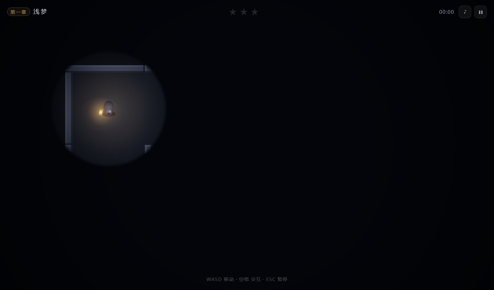
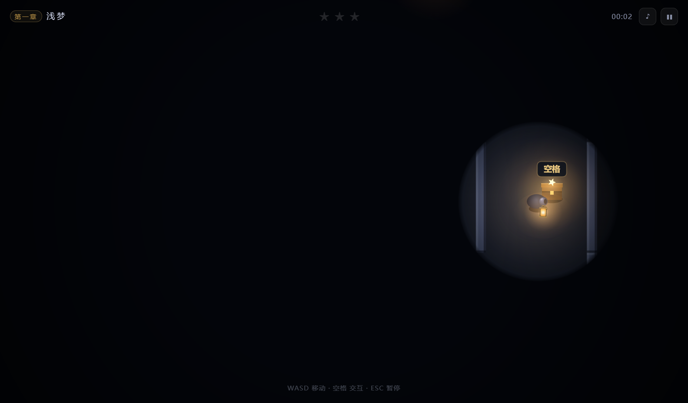
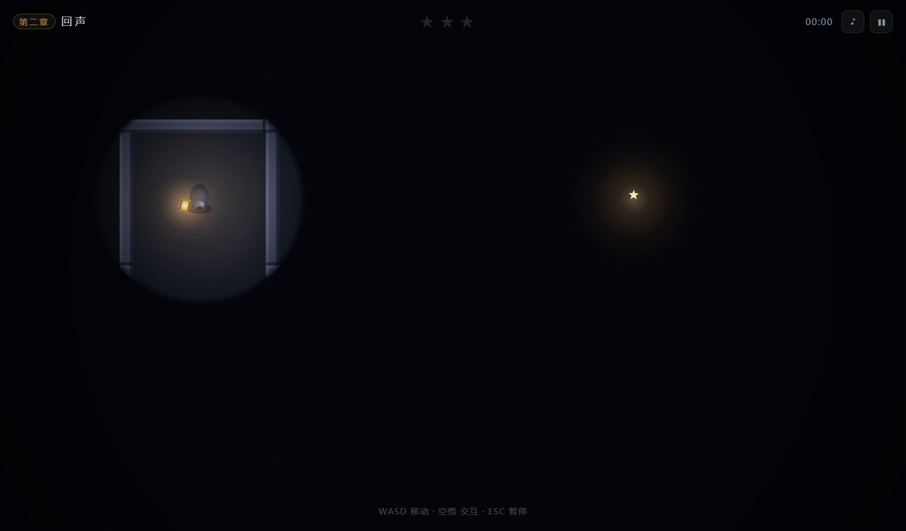

# 孤灯迷径 · Lone Lantern

> 提着一盏灯，走进黑暗的迷宫。

一个用 **Canvas 2D + 原生 JavaScript** 写的 2D 黑暗迷宫探索小游戏，打包成 Windows 免安装单文件 exe。
没有游戏引擎、没有下载的美术素材、没有第三方音频文件——画面和音效全部由代码实时生成。


## 玩法

你提着一盏灯走进迷宫。灯光只能照亮身边 4 个身位，越远越暗，4 个身位以外伸手不见五指。

迷宫里散布着**坑洞**和**会自动连发的弓箭口**，碰到任何一个都当场结束——你只有一条命。

每章藏着 **3 个宝箱**，各有一颗五角星。**集齐 3 颗星再走到出口**才算完美通关；星星没拿全也能出去，但成绩会打折。

宝箱的光可以穿透墙体和黑暗，所以远处看到一点星芒，说明那边有箱子。

## 三个章节

| 章节 | 难度 | 迷宫 | 坑洞 | 弓箭口 | 特点 |
| --- | --- | --- | --- | --- | --- |
| 一 · 浅梦 | 简单 | 7 × 7 | 5 | 2 | 高连通，岔路少 |
| 二 · 回声 | 困难 | 13 × 13 | 24 | 6 | 长廊多，箭矢回响 |
| 三 · 无归 | 地狱 | 19 × 19 | 46 | 11 | 死路极多，几乎全靠摸索 |

## 操作

| 按键 | 作用 |
| --- | --- |
| `W` `A` `S` `D` | 上下左右行走 |
| `空格` | 开宝箱 / 交互 |
| `ESC` | 暂停 · 回退 |

仅支持 Windows 桌面端（x64），无手机版。

## 截图

| 游戏内 | 开宝箱 |
| --- | --- |
|  |  |

| 章节选择 | 第二章（13×13） |
| --- | --- |
|  |  |

## 下载与运行

在 [Releases](../../releases) 页面下载最新的 `LoneLantern-vX.Y.Z.zip`，解压后双击 `孤灯迷径.exe`。
免安装、免联网，首次启动会先解压 3~5 秒。

> 这是无签名的自制程序，Windows SmartScreen 可能提示「已保护你的电脑」，
> 点「更多信息 → 仍要运行」即可。

## 本地开发

需要 Node 18+ 与 pnpm。

```bash
pnpm install
pnpm start
```

国内网络如果 `electron` 二进制下载卡住，先设置镜像：

```bash
# PowerShell
$env:ELECTRON_MIRROR="https://npmmirror.com/mirrors/electron/"
```

## 打包

```bash
pnpm run dist
```

产物在 `dist/` 下，是一个 portable 单文件 exe。

> 注意：`package.json` 里设了 `win.signAndEditExecutable: false`。
> 原因是 electron-builder 默认会解压 `winCodeSign` 并创建 macOS 符号链接，
> 在非管理员权限的 Windows 上必然失败；关掉后用 NSIS 直接把图标编译进外壳，实测没问题。
> 副作用是用 `win-unpacked/` 里的裸 exe 做二次分发时，内嵌图标是 Electron 默认图标。

## 资源与音效

图标和音效都是程序生成的，改了随时重跑：

```bash
pnpm run assets   # 重新生成图标(assets/icon.*) 与音效(src/sfx-data.js)
```

- `tools/gen-icon.js`：用 SDF 逐像素光栅化画提灯图标，输出多尺寸 `.ico`（小尺寸用 BMP 条目、大尺寸用 PNG 压缩以保证兼容）。
- `tools/gen-sfx.js`：用正弦/噪声/包络合成 8 个音效与环境低频，编码成 WAV 再内联为 base64，运行时用 WebAudio 解码播放。
- `tools/test-maze.js`：离线校验三章迷宫能否正常生成且保证可通行。

## 代码结构

```
index.html / styles.css   界面骨架与样式
src/main.js               入口、主循环、自动化测试接口
src/game.js               渲染 / 光照 / 玩法循环 / 碰撞
src/maze.js               迷宫生成 + 可通行性校验
src/levels.js             单位定义与三章参数
src/input.js              键盘输入
src/ui.js                 菜单、结算、进度存档
src/audio.js              WebAudio 播放
src/sfx-data.js           内联音效（生成物，已入库以便开箱即用）
electron/main.js          Electron 主进程 + 自测入口
tools/                    图标 / 音效 / 迷宫生成器
```

## 几个实现细节

- **单位系统**：一个"身位" = 44 世界像素。走廊净宽 5 身位、墙厚 0.5 身位、坑洞直径 3 身位。
- **光照**：在屏幕空间画一张黑色遮罩，用径向渐变按距离擦除 alpha（1 身位 100% → 4 身位 40%），边界外完全不擦，因此是真黑。相机视野 10 身位，视野外不渲染。
- **迷宫生成**：DFS 生成完美迷宫，再按概率打通死胡同形成环路。生成后用 8px 细网格 BFS 校验起点、三个宝箱、出口全部可达（坑洞按致死半径视为不可通行、墙按玩家半径膨胀），不通过就换种子重来。
- **碰撞**：分轴移动 + `min/max` 夹取，并在每帧末尾把坐标**硬钳制**在迷宫外墙内侧。早期版本这里有个 bug：贴墙反向移动时会从墙的外侧被推出去，直接飞出地图、相机又跟不出去，表现就是"视角被拖到地图外、看不见小人"。
- **自动化测试**：`孤灯迷径.exe --selftest` 会跑三章随机走位压力测试（检测 NaN / 出界 / 离屏）、相机四角安全区测试和完整流程测试（移动 → 开箱 → 中箭 → 落坑 → 通关），并输出截图。

## 许可

[MIT](LICENSE)。代码、程序生成的图标与音效均随本仓库以 MIT 发布，不含任何第三方版权素材。
